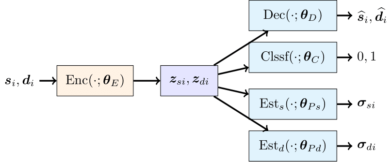
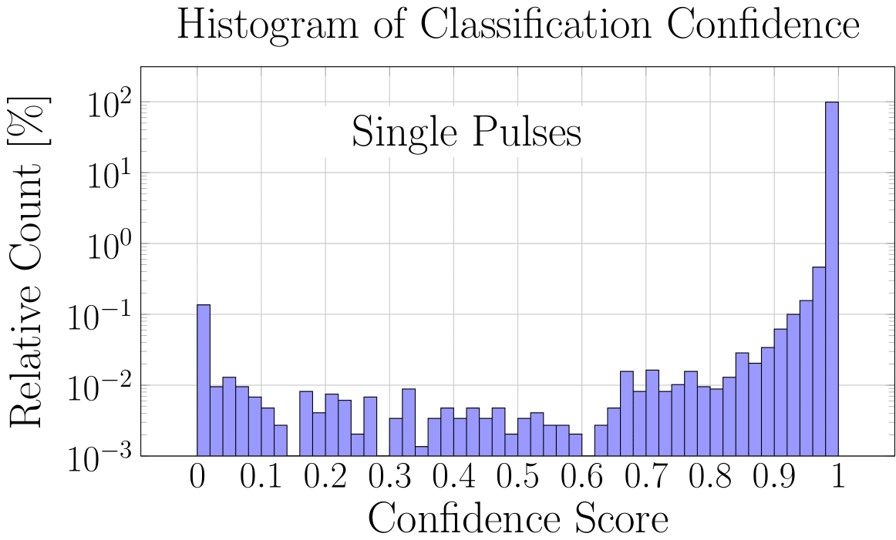
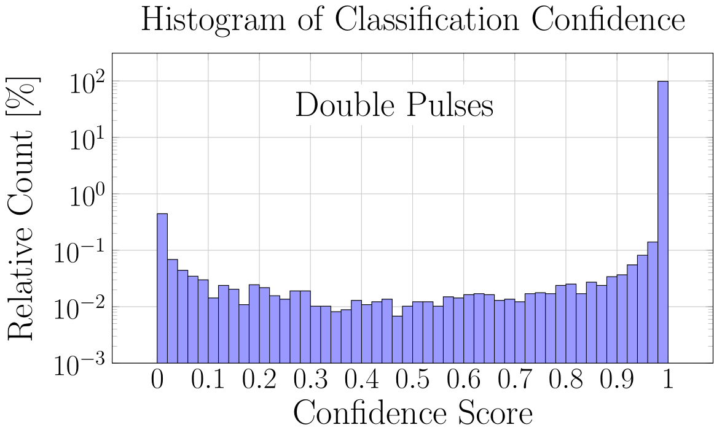

# SAEFit

Paper: [**A Machine Learning Framework for Accurate and Robust Analysis of Radiation Detector Pulses**](https://doi.org/10.1016/j.nima.2025.170971)

Self-supervised pulse fitting and double-pulse classification with PyTorch Lightning.  
From a set of real single-pulse traces, the dataloader synthesizes double pulses (shifted + amplitude-scaled), and the model (`SAEFit`) learns to (1) reconstruct pulses, (2) estimate pulse parameters, and (3) classify single vs. double.

**Authors:**  
[**Bashir Sadeghi**](https://github.com/sadeghi-bashir) ·
**Dustin Scriven** ·
[**Aaron Chester**](https://github.com/aschester) ·
[**Ronald Fox**](https://github.com/rfoxkendo) ·
**Sean Liddick** ·
[**Giordano Cerizza**](https://github.com/gcerizza)

**Maintainer:** [Bashir Sadeghi](https://github.com/sadeghi-bashir) — sadeghi@frib.msu.edu

---

## Overview

<p align="center">
  
</p>

## Results

<p align="center">
  
  
</p>


---

## Table of Contents
- Setup
- Data
- Quickstart
- Configuration (INI)
- Project Layout
- Notes (Dataloader & Logging)
- License
- Citing

---

## Setup
> Requires Python 3.10+.

1- Clone the repository

    git clone https://github.com/sadeghi-bashir/SAEFit.git
    cd SAEFit

2- Install PyTorch (pick ONE line that matches your system)

Linux (CPU only):

    pip3 install torch torchvision --index-url https://download.pytorch.org/whl/cpu 

Linux (CUDA 12.9):

    pip3 install torch torchvision --index-url https://download.pytorch.org/whl/cu129

Mac:

    pip3 install torch torchvision


For more options see https://pytorch.org

3- Install the project dependencies

    pip install -r requirements.txt

---

## Data

Place the binary with single-pulse traces here (default):

    ./data/real_single_traces.bin

You can change the location via `features_path` in `exps/saefit.ini`, e.g.:

    features_path = ./your_data_folder

### Expected binary format
The default loader expects a stream of variable-length records:
- Each record starts with a 32-bit unsigned integer `N` (little-endian) giving the number of samples, followed by `N` unsigned 16-bit samples.
- Pulses with max value `>= 16383` are skipped as “saturated” (adjust based on your data).
- A baseline offset is removed using the smallest `centering_wid` samples per trace.

### Using a different format
If your data isn’t in this format, adapt the dataset file (e.g., `lab/datasets/pulse_saefit.py`) to read your source and return the same tensors per sample:
`(x1, x2, x=x1+x2, m1, m2, m, dt)` where `m*` are per-trace maxima and `dt` is the second-pulse delay.

---

## Quickstart

Train (logs + checkpoints):

CPU:

    python main.py --args exps/saefit.ini --ngpu=0

GPU:

    python main.py --args exps/saefit.ini --ngpu=<# of gpus>

Mac (MPS is used automatically if available; --ngpu=0 prevents CUDA path):

    python main.py --args exps/saefit.ini --ngpu=0


Test on the best checkpoint saved by training (or provide your own):

    python main.py --args exps/saefit.ini --nepochs 0 --resume path/to/checkpoint.ckpt
    Or you can point to checkpoint via `resume` in the INI (see below).

TensorBoard:

    tensorboard --logdir results/<result_subdir>

> By default, logging goes under `results/args.result_subdir` (see your `config.py` handler and `exps/saefit.ini`).

---

## Configuration (INI)

Minimal example (`exps/saefit.ini`):

    [Arguments]

    project_name = 2Pulse-SAEFit
    dataset = Pulse_SAEFit
    dataset_options = {"seed": 0, "ratio_train": 0.7, "ratio_test": 0.2}

    features_path = ./data

    precision = 16
    batch_size_train = 1000
    batch_size_val   = 120000
    batch_size_test  = 120000

    manual_seed = 0
    nepochs = 50
    init_epochs = 1
    check_val_every_n_epochs = 25

    optim_method = AdamW
    learning_rate = 1e-3
    optim_options = {"weight_decay": 2e-5}
    scheduler_method = StepLR
    scheduler_options = {"step_size": 10, "gamma": 0.9}

    centering_wid = 15
    t_res = 30, 60, 90, 120, 150, 175     ; double-pulse time gaps (bins)
    a_res = 2, 4, 6, 8, 10                ; amplitude scale ranges

    loss_type  = Regression
    loss_options = {"reduction": "mean"}
    loss_type2 = Classification

    evaluation_type_1 = Accuracy
    evaluation_options_1 = {"task": "multiclass", "num_classes": 2}
    evaluation_type_2 = SignalNoiseRatio
    evaluation_options_2 = {}
    evaluation_type_3 = ConfusionMatrix
    evaluation_options_3 = {"task": "multiclass", "num_classes": 2}

    ngpu = 1
    nthreads = 0

Key knobs:
- `t_res` controls bins used to sample the **second-pulse delay** (Δt).
- `a_res` controls amplitude scaling buckets.
- `centering_wid` subtracts a per-trace offset (robust average over the minimum `centering_wid` samples).
- `batch_size_*` and `precision` affect speed/memory.

---

## Project Layout

- `main.py` — entry point (parses INI via `config`, sets up Trainer, logger, checkpoints).
- `control.py` — Lightning `SAEFit` module (manual optimization, metrics, logging).
- `lab/` — models, losses, dataloaders, metrics, and custom schedulers.
- `lab/datasets/pulse_saefit.py` — `Pulse_SAEFit` datamodule and `PulsePrepare` dataset (synthetic double-pulse generation).
- `exps/saefit.ini` — experiment config file.
- `results/` — logs, checkpoints, and exported artifacts.

---

## Notes

### Dataloader (`lab/datasets/pulse_saefit.py`)
- Loads `real_single_traces.bin`, filters saturated traces.
- Optional centering by robust mean over the first `centering_wid` samples.
- Splits into train/val/test with `train_test_split`.
- Synthesizes double pulses by:
  - Shifting the first pulse (`t1_shifts`),
  - Shifting the second pulse relative to the first (`t_diffs`),
  - Scaling amplitudes (`a_scales`).
- Returns tensors per sample: `(x1, x2, x = x1+x2, m1, m2, m, dt)` where `m*` are per-trace maxima and `dt` is the second-pulse delay in bins.

### Logging & Artifacts
- TensorBoard scalars (losses, SNR, accuracy, confusion-matrix stats).
- During test, saves visualizations to TensorBoard and per-pulse `.txt` arrays under `results/.../pulses/` (fits, data, probabilities, delays, etc.).

---


## License

**Code License — Apache-2.0**

This repository is licensed under the Apache License, Version 2.0. Include the full text as `LICENSE` at the repo root.


## Citing

If you use this code or the accompanying paper, please cite:

### Paper
```bibtex
@article{Sadeghi2025SAEFit,
  title   = {A Machine Learning Framework for Accurate and Robust Analysis of Radiation Detector Pulses},
  author  = {Sadeghi, Bashir and Scriven, Dustin and Chester, Aaron and Fox, Ronald and Liddick, Sean and Cerizza, Giordano},
  journal = {Nuclear Instruments and Methods in Physics Research Section A},
  year    = {2025},
  doi     = {10.1016/j.nima.2025.170971},
  url     = {https://doi.org/10.1016/j.nima.2025.170971},
  note    = {Code available at https://github.com/sadeghi-bashir/SAEFit}
}
```

### Software
```bibtex
@software{Sadeghi_SAEFit_2025,
  author  = {Sadeghi, Bashir and Scriven, Dustin and Chester, Aaron and Fox, Ronald and Liddick, Sean and Cerizza, Giordano},
  title   = {SAEFit: Self-Supervised Pulse Fitting and Double-Pulse Classification},
  year    = {2025},
  version = {v1.0.0},
  url     = {https://github.com/sadeghi-bashir/SAEFit},
  note    = {Apache-2.0}
}
```
